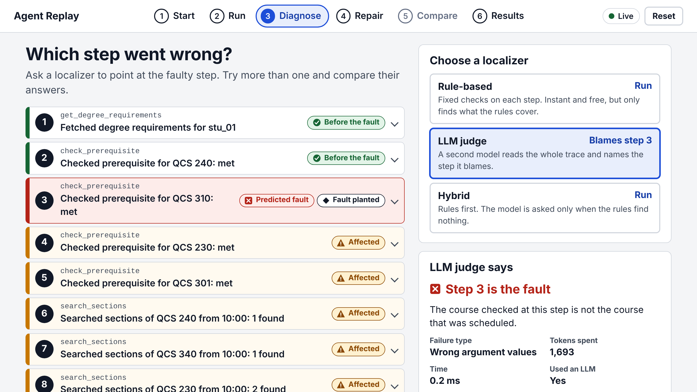

# Agent Replay

Find the step where an AI agent run went wrong, fix that step, and resume from it.

An agent failed at the last step. The bug was three steps earlier. Most debugging looks at the last step. Agent Replay records every step of a run, names the step it suspects, lets you repair that step, and continues from there without rerunning the steps that were fine.

This is a research project with a working tool attached.

## The research question

How does the accuracy of failure localization affect the success, cost, and latency of checkpoint-based agent recovery?

Three narrower questions:

1. Does an LLM judge find meaning-level tool-use errors more accurately than rule-based checks alone?
2. How much does recovery success drop when the predicted step is one or two steps away from the true error?
3. After counting diagnosis, repair, and replay costs, does checkpoint recovery beat a full restart?

A negative result counts. If a full restart turns out more reliable for some failure types, that is a finding.

## How it works

- **The agent under test** is a semester planner over a synthetic course catalog. It has four tools: `get_degree_requirements`, `check_prerequisite`, `search_sections`, `build_schedule`. A deterministic validator gives every final schedule a pass or fail.
- **The trace recorder** saves every step to SQLite: what the model saw, the tool call, the output, tokens, seconds, and a checkpoint of the agent's state.
- **Fault injection** plants one specific error at one step, for example a wrong course code in a prerequisite check. Everything after that step runs for real. It is the only scripted part.
- **Three localizers** name the step they suspect: rule-based checks, an LLM judge, and a hybrid that runs the rules first and calls the judge only when they find nothing.
- **Three recovery strategies** are compared: a full restart, resuming at the predicted step with the diagnosis as a hint, and resuming at the true step with the correct action (the best case).
- **Cost is counted honestly.** Recovery cost is localization plus repair plus replay tokens, compared with the tokens of a full restart.

The design, with every judgment call marked, is in [docs/DESIGN.md](docs/DESIGN.md).

## What it looks like



The six screens are in [docs/screenshots](docs/screenshots): start, run timeline, diagnose, repair, compare, results. These screenshots were taken with the test stand-in for the model, not the OpenAI API. Any number visible in them, including on the results screen, is test data and not a result.

## Results

**The experiment has not been run yet.** There are no numbers in this repository, and the results screen in the app says so. Every number shown anywhere must come from a stored run.

To produce them, with an OpenAI key in `.env`:

```bash
make label
```

```bash
make experiment ID=nov-final
```

```bash
make export ID=nov-final
```

```bash
make freeze ID=nov-final VERSION=v1
```

`make label` confirms each scenario's label with counterfactual runs. `make experiment` prints the planned number of runs and a token estimate and waits for a yes. If it stops halfway, run it again and it skips what is finished.

Then print the tables for this section from the frozen results file and paste them here:

```bash
backend/.venv/bin/python -m agent_replay.experiments table
```

## Run it

With Docker, one command after creating `.env` from `.env.example`:

```bash
docker compose up --build
```

Then open http://localhost:8000.

Without Docker:

```bash
make install
```

```bash
cd frontend && npm run build && cd ..
```

```bash
make serve
```

Run one scenario from the terminal and print its trace:

```bash
cd backend && .venv/bin/python -m agent_replay.run --scenario ../scenarios/scenario_01.yaml
```

Diagnose a stored run:

```bash
cd backend && .venv/bin/python -m agent_replay.localize --run RUN_ID --method hybrid
```

## Configuration

Everything is set through environment variables. See `.env.example`.

| Variable | Meaning |
|---|---|
| `OPENAI_API_KEY` | Used on the server only. |
| `OPENAI_MODEL`, `JUDGE_MODEL` | Model for the planner agent and for the LLM judge. No default: you choose and record them. |
| `MAX_STEPS_PER_RUN`, `MAX_TOKENS_PER_RUN`, `MAX_COMPLETION_TOKENS` | Limits on one run and on one model reply. |
| `DAILY_TOKEN_LIMIT` | New live runs are refused once this many tokens were used today. |
| `DEMO_MODE`, `DEMO_SCENARIOS` | In demo mode only the listed scenarios can be started. |
| `OFFLINE` | Run from recorded responses with no network. |
| `DATABASE_PATH` | The SQLite file. |

## Tests

```bash
make test
```

This runs the backend tests, the frontend tests, and a browser test of the full flow. None of them calls the OpenAI API: they use a small deterministic stand-in for the model in `backend/tests/fake_model.py`. That stand-in exists only to exercise the code. Nothing it produces is a result.

One real scenario end to end, which costs tokens:

```bash
make live-smoke
```

## Showcase day

```bash
make record
```

records the demo scenarios once, with the network on, so they can run with `OFFLINE=1`.

```bash
make preflight
```

prints a pass or fail list: the API key works, the token limits are set, the demo scenarios load, offline mode works, the frozen results are present, and the production URL is healthy.

Deployment to Google Cloud Run is described in [docs/DEPLOY.md](docs/DEPLOY.md). The security review is in [docs/SECURITY.md](docs/SECURITY.md).

## Limitations

- **Synthetic data.** The catalog, the students and the faults are invented. Results on a controlled planner may not carry over to messier real agents.
- **Injected faults, not natural ones.** The error is planted by the injector and written into the agent's history as if the agent had made it. Real agent mistakes may look different.
- **Faults are one-time events.** A restart or a resume does not get the fault again. This is what makes a restart a fair baseline, and it shapes every recovery number.
- **Two errors at once.** A localizer may find only one, and one successful replay does not prove a single cause.
- **Side effects.** Resuming needs a state that can be restored. The planner's tools only read. Real actions such as sent emails cannot be undone.
- **The judge can be confidently wrong.** Its written reason is always shown for that reason.
- **Nondeterminism.** A resumed run can take a different path even without the bug. Every condition runs three times, which is still a small sample. Results should be read as counts, not only percentages.
- **Rules and scenarios have one author.** The rule-based checks are written against the tool schemas and the catalog and never see the scenario files, but the same person wrote both.
- **Offline mode replays recordings.** A visitor action that was not recorded cannot run offline.

## Related work

Automated failure attribution for LLM agents is an active research area. Start with the Who&When benchmark (Zhang et al., 2025, "Which Agent Causes Task Failures and When? On Automated Failure Attribution of LLM Multi-Agent Systems"), which asks which agent and which step caused a failure. This project looks at the step after attribution: whether recovering from the identified step succeeds, and what it costs.

The failure types (wrong tool, invalid arguments, wrong argument values, goal not met, tool failure, wasted steps) and the approach to evaluation (exact checks first, an AI judge where code cannot decide, cost and latency as part of quality) follow Chip Huyen's *AI Engineering*.
