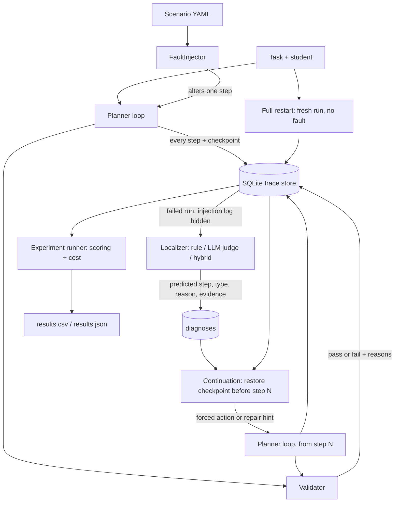

# Agent Replay: Design

Status: draft for review. No application code exists yet.

Lines marked **Judgment call** are decisions I made that you may want to change. Section 10 lists the ones that matter most.

Decisions already confirmed with you:

- A small model runs the planner and a stronger model runs the judge. Both ids come from `OPENAI_MODEL` and `JUDGE_MODEL`.
- One model turn is one step. Parallel tool calls are off, so a step has at most one tool call.
- An injected fault is written into the agent's own message history, so the trace reads as the agent's mistake. Faults are targeted by tool and occurrence, not by a fixed step number.
- The injector supports a small set of fault kinds, not only argument changes.

## 1. Components

All modules live in `backend/agent_replay/`.

| Module | Owns | Calls |
|---|---|---|
| `catalog` | Synthetic courses, sections, student profiles (one JSON file) and lookups | nothing |
| `validator` | Deterministic pass or fail for a schedule, with every reason | `catalog` |
| `planner` | The four tool functions, their JSON schemas, the system prompt, and the agent loop | `catalog`, `validator`, `tracing`, `injection`, OpenAI |
| `tracing` | SQLite schema, `TraceRecorder`, reading runs back | sqlite3 |
| `injection` | Scenario loading, `FaultInjector` | `catalog` (to check a scenario is well formed) |
| `localizers` | `RuleBasedLocalizer`, `LLMJudgeLocalizer`, `HybridLocalizer`, the judge prompt file | `tracing`, `catalog`, `planner` (tool schemas), OpenAI |
| `recovery` | Agent continuation, full restart, deterministic replay, counterfactual labeling | `planner`, `tracing`, `injection` |
| `experiments` | Experiment runner, scoring, cost accounting, results export | `localizers`, `recovery`, `tracing` |
| `api` | FastAPI app, request and response models, static frontend | everything above |

The agent loop lives in one function, `run_agent`, that takes a starting state. A fresh run starts from an empty state. A continuation starts from a stored checkpoint. There is no second loop for recovery.



## 2. Data model (SQLite)

Ids are `uuid4().hex` text. JSON is stored as text. Times are ISO 8601 UTC text.

```sql
CREATE TABLE scenarios (
    id                    TEXT PRIMARY KEY,      -- "scenario_01"
    title                 TEXT NOT NULL,
    failure_type          TEXT NOT NULL,         -- FailureType of the first injection
    yaml_sha256           TEXT NOT NULL,         -- detects edits after labeling
    definition_json       TEXT NOT NULL,         -- the parsed YAML file
    label_status          TEXT NOT NULL DEFAULT 'unlabeled',
                          -- unlabeled | confirmed | not_recovered | no_failure
    counterfactual_trials INTEGER,
    counterfactual_passes INTEGER,
    label_source_run_id   TEXT REFERENCES runs(id),
    labeled_at            TEXT
);

CREATE TABLE runs (
    id                    TEXT PRIMARY KEY,
    scenario_id           TEXT REFERENCES scenarios(id),
    kind                  TEXT NOT NULL,
                          -- original | full_restart | continuation
    purpose               TEXT NOT NULL,
                          -- experiment | labeling | visitor | test
    experiment_id         TEXT,
    trial                 INTEGER,
    parent_run_id         TEXT REFERENCES runs(id),  -- continuation, restart
    branch_step           INTEGER,                   -- continuation only
    continuation_mode     TEXT,                      -- forced_action | repair_hint
    agent_name            TEXT NOT NULL,
    student_id            TEXT NOT NULL,
    user_request          TEXT NOT NULL,
    constraints_json      TEXT NOT NULL,
    model                 TEXT NOT NULL,
    temperature           REAL,
    status                TEXT NOT NULL,
                          -- running | passed | failed | error
    stop_reason           TEXT,
                          -- finished | max_steps | max_tokens | api_error
    final_schedule_json   TEXT,
    validator_reasons_json TEXT,
    injected_step         INTEGER,   -- actual step the first fault landed on
    observed_failure_step INTEGER,
    prompt_tokens         INTEGER NOT NULL DEFAULT 0,  -- new model calls only
    completion_tokens     INTEGER NOT NULL DEFAULT 0,
    total_seconds         REAL NOT NULL DEFAULT 0,
    created_at            TEXT NOT NULL,
    ended_at              TEXT
);
CREATE INDEX idx_runs_scenario ON runs(scenario_id, kind);
CREATE INDEX idx_runs_experiment ON runs(experiment_id, scenario_id, trial);
CREATE INDEX idx_runs_parent ON runs(parent_run_id);

CREATE TABLE steps (
    id                TEXT PRIMARY KEY,
    run_id            TEXT NOT NULL REFERENCES runs(id),
    step_number       INTEGER NOT NULL,          -- 1-based
    model_input_json  TEXT NOT NULL,             -- messages actually sent
    model_output_json TEXT NOT NULL,             -- assistant message as stored in history
    tool_name         TEXT,                      -- NULL on the final step
    tool_call_id      TEXT,
    tool_args_json    TEXT,                      -- arguments as executed
    tool_output_json  TEXT,                      -- output as the agent saw it
    prompt_tokens     INTEGER NOT NULL,
    completion_tokens INTEGER NOT NULL,
    seconds           REAL NOT NULL,
    checkpoint_json   TEXT NOT NULL,             -- state before this step, see section 4
    depends_on_json   TEXT NOT NULL,             -- list of earlier step numbers
    injection_json    TEXT,                      -- NULL, or the fault log (hidden from localizers)
    origin            TEXT NOT NULL DEFAULT 'model',
                      -- model | forced | reused
    reused_from_step_id TEXT REFERENCES steps(id),
    UNIQUE (run_id, step_number)
);

CREATE TABLE diagnoses (
    id               TEXT PRIMARY KEY,
    run_id           TEXT NOT NULL REFERENCES runs(id),
    method           TEXT NOT NULL,              -- rule | llm | hybrid
    predicted_step   INTEGER,                    -- NULL means "no finding"
    failure_type     TEXT,
    reason           TEXT NOT NULL,
    evidence_json    TEXT NOT NULL,
    tokens           INTEGER NOT NULL,
    seconds          REAL NOT NULL,
    judge_model      TEXT,
    judge_temperature REAL,
    raw_response     TEXT,                       -- judge output before parsing
    used_llm         INTEGER NOT NULL,           -- hybrid: 0 when rules decided
    verification_run_id TEXT REFERENCES runs(id),
    created_at       TEXT NOT NULL
);
CREATE INDEX idx_diagnoses_run ON diagnoses(run_id, method);

CREATE TABLE recoveries (
    id                  TEXT PRIMARY KEY,
    experiment_id       TEXT,
    scenario_id         TEXT NOT NULL REFERENCES scenarios(id),
    trial               INTEGER,
    original_run_id     TEXT NOT NULL REFERENCES runs(id),
    strategy            TEXT NOT NULL,
                        -- full_restart | resume_true | resume_predicted
    method              TEXT,                    -- NULL for the two shared baselines
    diagnosis_id        TEXT REFERENCES diagnoses(id),
    recovery_run_id     TEXT NOT NULL REFERENCES runs(id),  -- may be shared
    resume_step         INTEGER,
    task_success        INTEGER NOT NULL,
    localization_tokens INTEGER NOT NULL,
    repair_tokens       INTEGER NOT NULL,
    replay_tokens       INTEGER NOT NULL,
    total_tokens        INTEGER NOT NULL,        -- always the sum of the three
    seconds             REAL NOT NULL,
    UNIQUE (experiment_id, scenario_id, trial, strategy, method)
);

CREATE TABLE experiment_results (
    id            TEXT PRIMARY KEY,
    experiment_id TEXT NOT NULL,
    group_kind    TEXT NOT NULL,     -- localizer | strategy | scenario
    group_key     TEXT NOT NULL,     -- e.g. "hybrid" or "resume_predicted:llm"
    metric        TEXT NOT NULL,     -- e.g. "exact_step_accuracy"
    value         REAL,
    numerator     INTEGER,
    denominator   INTEGER,
    run_ids_json  TEXT NOT NULL,     -- every run behind this number
    computed_at   TEXT NOT NULL,
    UNIQUE (experiment_id, group_kind, group_key, metric)
);
```

Notes:

- A continuation run copies steps 1 to N-1 from its parent with `origin = 'reused'`. The copies keep their original token counts for display, but run totals and cost accounting only count steps where `origin = 'model'`. This lets the timeline and deterministic replay read one run without following parent links.
- The unique key on `recoveries` is what makes the runner resumable: a finished cell is skipped on rerun.
- `experiment_results.run_ids_json` exists so every displayed number traces back to stored runs.

## 3. Core interfaces

Shared types (Pydantic v2 models):

```python
class FailureType(str, Enum):
    WRONG_TOOL = "wrong_tool"
    INVALID_ARGUMENTS = "invalid_arguments"
    WRONG_ARGUMENT_VALUES = "wrong_argument_values"
    GOAL_NOT_MET = "goal_not_met"
    TOOL_FAILURE = "tool_failure"
    WASTED_STEPS = "wasted_steps"

class ToolCall(BaseModel):
    tool_name: str
    arguments: dict[str, Any]

class Constraints(BaseModel):
    earliest_start: str | None = None   # "10:00", 24-hour
    max_credits: int | None = None      # falls back to the student's limit
```

### Planner tools

```python
def get_degree_requirements(student_id: str) -> dict:
    """Return the student's major, completed courses, remaining required
    courses, must-take courses for this term, and credit limits."""

def check_prerequisite(student_id: str, course_code: str) -> dict:
    """Return {"course_code", "met": bool, "missing": [codes]} for one course.
    Returns {"error": ...} if the course code is not in the catalog."""

def search_sections(course_code: str, earliest_start: str | None = None) -> dict:
    """Return the sections of one course (section id, days, start, end,
    credits), optionally only those starting at or after earliest_start."""

def build_schedule(student_id: str, section_ids: list[str]) -> dict:
    """Assemble a schedule from section ids. Rejects unknown section ids and
    time conflicts between the chosen sections. Does NOT check prerequisites,
    the earliest-start rule, or required courses. Those are the validator's
    job, which is what lets an early mistake reach the end of a run."""
```

Arguments are validated against each tool's JSON schema before the tool runs. A schema failure is returned to the model as an error tool output, not raised.

**Judgment call**: the schedule that gets validated is the output of the last successful `build_schedule` call. The run ends when the model replies with no tool call; that reply is the final step and the validator verdict is attached to it. No `build_schedule` call means a failed run with reason `no_schedule`.

### Validator

```python
class ValidationResult(BaseModel):
    passed: bool
    reasons: list[ValidationReason]   # empty when passed

class ValidationReason(BaseModel):
    code: Literal["unmet_prerequisite", "time_conflict", "before_earliest_time",
                  "missing_required_course", "credit_limit_exceeded",
                  "invalid_schedule", "no_schedule"]
    message: str                      # plain words, shown in the UI
    course_codes: list[str]
    section_ids: list[str]

def validate_schedule(student: Student, schedule: Schedule | None,
                      constraints: Constraints) -> ValidationResult:
    """Deterministic check, no LLM. Collects every reason, never stops at the
    first one."""
```

`missing_required_course` means a course in the student's `must_take` list is absent. Profiles are written so every must-take course is one the student is eligible for.

### TraceRecorder

```python
class TraceRecorder:
    def __init__(self, db_path: str) -> None: ...

    def start_run(self, *, scenario_id: str | None, kind: str, purpose: str,
                  student_id: str, user_request: str, constraints: Constraints,
                  model: str, temperature: float | None,
                  parent_run_id: str | None = None,
                  branch_step: int | None = None,
                  continuation_mode: str | None = None,
                  experiment_id: str | None = None,
                  trial: int | None = None) -> str:
        """Insert a run with status 'running' and return its id."""

    def record_step(self, run_id: str, step: StepRecord) -> str:
        """Insert one step, including its checkpoint, in one transaction.
        Token counts come from the API response usage field."""

    def copy_reused_steps(self, run_id: str, parent_run_id: str,
                          up_to_step: int) -> None:
        """Copy steps 1..up_to_step from the parent with origin 'reused'."""

    def end_run(self, run_id: str, *, status: str, stop_reason: str,
                final_schedule: Schedule | None,
                validation: ValidationResult | None,
                observed_failure_step: int | None) -> None:
        """Close the run and write totals summed from its non-reused steps."""

    def load_run(self, run_id: str) -> StoredRun:
        """Return the run and its ordered steps."""
```

There is no separate `save_checkpoint` call. The checkpoint is a field of `StepRecord`, so a step can never be stored without one.

### FaultInjector

```python
class FaultKind(str, Enum):
    REPLACE_ARGUMENT = "replace_argument"   # one argument gets a wrong value
    REPLACE_TOOL_CALL = "replace_tool_call" # the call is swapped for another tool
    REPLACE_TOOL_OUTPUT = "replace_tool_output"  # real call, altered output
    REPEAT_CALL = "repeat_call"             # redundant copies of the previous call
    DROP_CONSTRAINT = "drop_constraint"     # one model input loses a constraint

class Target(BaseModel):
    tool: str | None            # tool the model is about to call
    occurrence: int = 1         # nth matching call in the run
    where: dict[str, Any] = {}  # optional exact match on arguments
    at_step: int | None = None  # only for DROP_CONSTRAINT, which has no tool yet

class Injection(BaseModel):
    kind: FaultKind
    target: Target
    argument: str | None = None       # REPLACE_ARGUMENT
    value: Any = None                 # the wrong value, call, or output
    times: int = 1                    # REPEAT_CALL
    failure_type: FailureType

class FaultInjector:
    def __init__(self, injections: list[Injection]) -> None: ...

    def alter_model_input(self, step_number: int,
                          messages: list[dict]) -> tuple[list[dict], InjectionLog | None]:
        """DROP_CONSTRAINT only. Returns the messages to send at this step."""

    def alter_tool_call(self, step_number: int,
                        call: ToolCall) -> tuple[ToolCall, InjectionLog | None]:
        """Called as the call goes out. Returns the call to execute and to
        write into history. Logs the original and injected values."""

    def alter_tool_output(self, step_number: int, call: ToolCall,
                          output: dict) -> tuple[dict, InjectionLog | None]:
        """REPLACE_TOOL_OUTPUT only."""

    def unfired(self) -> list[Injection]:
        """Injections whose target never occurred. A run with any of these is
        flagged as 'fault not delivered' and kept, not dropped."""
```

Each injection fires once. A run with no injector behaves exactly like the plain agent. Recovery runs never get an injector (see section 7).

### Localizer

```python
class Evidence(BaseModel):
    step_number: int
    field: str          # "tool_args.course_code", "tool_output.met", ...
    value: Any
    note: str = ""

class Diagnosis(BaseModel):
    method: Literal["rule", "llm", "hybrid"]
    predicted_step: int | None        # None means no finding
    failure_type: FailureType | None
    reason: str                       # one sentence
    evidence: list[Evidence]
    tokens: int
    seconds: float
    used_llm: bool
    checks_passed: list[str] = []     # rule checks that found nothing

class Localizer(Protocol):
    method: str
    def localize(self, run: LocalizerView) -> Diagnosis:
        """Name the step where the run went wrong."""
```

`LocalizerView` is the stored run without `injection_json`, without the scenario definition, and without the `origin` column. A localizer sees what a developer debugging a real agent would see: the request, the steps, and the validator's verdict.

### Continuation

```python
def continue_run(recorder: TraceRecorder, client: OpenAI, *,
                 parent_run_id: str, step: int,
                 mode: Literal["forced_action", "repair_hint"],
                 forced_action: ToolCall | None = None,
                 hint: RepairHint | None = None,
                 purpose: str = "experiment") -> str:
    """Restore the checkpoint from just before `step` and run forward.
    Steps before `step` are copied from storage, never re-called.
    forced_action: step N is the given call, executed for real, with no model
    call for that step. The model takes over from step N+1.
    repair_hint: the hint is appended to the restored messages and the model
    regenerates step N.
    Returns the id of the new run, linked to its parent and branch step."""

def full_restart(recorder: TraceRecorder, client: OpenAI, *,
                 parent_run_id: str, purpose: str = "experiment") -> str:
    """Run the same task from step 1 with no injector."""

def replay_deterministic(recorder: TraceRecorder, run_id: str) -> ReplayResult:
    """Rebuild the run from recorded outputs with zero model calls and report
    whether the rebuilt messages and final schedule match what was stored."""
```

## 4. Checkpoint format

A checkpoint is the full agent state immediately before a step's model call:

```json
{
  "step_number": 3,
  "messages": [
    {"role": "system", "content": "..."},
    {"role": "user", "content": "Build my Spring schedule ..."},
    {"role": "assistant", "content": null, "tool_calls": [{"id": "call_a1", "type": "function", "function": {"name": "get_degree_requirements", "arguments": "{\"student_id\": \"stu_01\"}"}}]},
    {"role": "tool", "tool_call_id": "call_a1", "content": "{...}"}
  ],
  "latest_schedule": null,
  "tokens_used": 1840,
  "steps_used": 2
}
```

Why this is enough: the planner uses the Chat Completions API, which is stateless. The message list is the whole conversation, and `latest_schedule`, `tokens_used`, and `steps_used` are the only state the loop keeps outside it. Restoring is loading this JSON and calling `run_agent` with it as the starting state.

- Message history is restored verbatim, including assistant `tool_calls` entries and their matching `tool` messages with the original `tool_call_id` values, so the API accepts the history as valid.
- Tool results are restored from the stored tool messages. Tools are never re-executed for earlier steps.
- If a fault was injected at an earlier step, the restored history contains the injected call and its real output. That is intended: resuming after the true step means resuming with a contaminated history.
- `tokens_used` and `steps_used` carry forward, so a continuation gets the same remaining budget the original had at that point.
- `model_input_json` on a step equals `checkpoint.messages` except under a `drop_constraint` fault, where it records what was actually sent.

**Judgment call**: the full message list is stored at every step. That is quadratic in run length, but a run is under about 15 steps and a few kilobytes per step. It keeps restore trivial and each step self-contained.

**Judgment call**: Chat Completions with `tools` and `parallel_tool_calls=false`, not the Responses API. The checkpoint must be a plain, self-contained message list with no server-side state.

## 5. Scenario file format

One YAML file per scenario in `scenarios/`.

```yaml
id: scenario_01
title: Prerequisite checked for the wrong course
description: >
  The agent checks the prerequisite for a different course than the one it
  planned to take. The tool answers truthfully for the course it was asked
  about, so the agent schedules a course the student is not eligible for.

task:
  student_id: stu_01
  user_request: "Build my Spring schedule for the CS major. No classes before 10am."
  constraints:
    earliest_start: "10:00"

injections:
  - kind: replace_argument
    failure_type: wrong_argument_values
    target:
      tool: check_prerequisite
      occurrence: 1
      where:
        course_code: "QCS 340"      # only fire on the check for this course
    argument: course_code
    value: "QCS 210"                # a real catalog course the student is eligible for

expected:
  injected_step: 3                  # where we expect the target to occur
  observed_failure_step: 6          # where we expect the validator to reject
  validator_reasons: [unmet_prerequisite]

limits:                             # optional per-scenario override
  max_steps: null
```

- `expected` is a prediction, used only to flag runs that went differently. The values that count are the actual `injected_step` and `observed_failure_step` stored on each run.
- The correct action for the forced-action fix is not written in the file. It is the call the model made before the injector changed it, which the injection log keeps. The file cannot disagree with what the agent actually intended.
- Two-error scenarios list two entries under `injections`.
- Course codes use an invented `QCS` prefix.

## 6. Failure types

From Chip Huyen's AI Engineering, as the `FailureType` enum in section 3:

| Value | Group in the book | Fault kind that produces it |
|---|---|---|
| `wrong_tool` | planning | `replace_tool_call` |
| `invalid_arguments` | planning | `replace_argument` with a value that fails the schema |
| `wrong_argument_values` | planning | `replace_argument` with a valid but wrong value |
| `goal_not_met` | planning | `drop_constraint` |
| `tool_failure` | tool | `replace_tool_output` |
| `wasted_steps` | efficiency | `repeat_call`, usually with a tight `limits.max_steps` |

## 7. Experiment matrix

Per scenario and trial:

1. One original run with the fault injected.
2. Each of the three localizers diagnoses that run.
3. One full restart (shared baseline).
4. One resume at the true step with the forced action (shared baseline).
5. One resume at the predicted step per localizer, with a repair hint.

Run count for 10 scenarios and 3 trials:

| Run type | Per scenario and trial | Total |
|---|---|---|
| Original failed run | 1 | 30 |
| Full restart (shared) | 1 | 30 |
| Resume at true step (shared) | 1 | 30 |
| Resume at predicted step | up to 3 | up to 90 |
| **Experiment total** | **up to 6** | **up to 180 agent runs** |
| Counterfactual labeling, done once before the experiment | | 10 originals + 30 continuations = 40 |
| **Grand total** | | **up to 220 agent runs** |

Localizer calls: 90 diagnoses. The rule-based ones cost no tokens. The LLM judge makes 30 calls and the hybrid makes at most 30, so at most 60 judge calls.

The 90 shrinks in three ways, all recorded, none hidden:

- Two localizers that predict the same step with the same failure type share one resume run.
- A localizer that returns "no finding" gets no resume run. It is scored as a failed recovery with zero replay cost.
- An original run that passes the validator anyway (the agent recovered by itself, or the fault was not delivered) gets no recovery runs. It is counted and reported as `no_failure`.

**Judgment call, the most important one**: the fault is a one-time event. Full restarts and continuations run with no injector. Otherwise a full restart would fail every time by construction, and the comparison would be meaningless. The consequence: resuming at or before the true step replaces the bad step, while resuming after it leaves the bad step in the history and relies on the hint alone. That asymmetry is what research question 2 measures.

**Judgment call**: the repair hint is built from a fixed template using only the predicted step, the call the agent made there, and the failure type. It leaves out the localizer's free-text reason. Two localizers with the same step and type then produce an identical hint, so sharing a run is exact. If you want the reason in the hint, sharing has to go and the count returns to a flat 90.

The true step used for scoring is the actual `injected_step` of that trial's original run, and only for scenarios whose label is `confirmed`. Unconfirmed scenarios stay in the results under their own heading.

Counterfactual labeling: one original run per scenario, then three forced-action continuations at the injected step. `confirmed` needs at least 2 of 3 to pass. Otherwise the scenario is marked `not_recovered` and flagged.

## 8. Cost accounting

All counts are `prompt_tokens + completion_tokens` from API responses. Nothing is estimated.

| Bucket | What is counted | Where |
|---|---|---|
| Localization | The judge call for `llm`; the judge call for `hybrid` when rules found nothing; zero for `rule`. Plus any standalone verification continuation run for that diagnosis. | `diagnoses.tokens`, plus the totals of `diagnoses.verification_run_id` |
| Repair | The single model call that regenerates step N with the hint in context. Zero in forced-action mode. | step N of the recovery run |
| Replay | Every model call after step N in the recovery run. | steps N+1 onward where `origin = 'model'` |
| Restart | Every model call of the fresh run. | `runs` totals of the full restart |

- `recovery cost = localization + repair + replay`, computed in one function in `experiments/cost.py` and stored on `recoveries`. Nothing else in the codebase adds these up.
- In the experiment, the resume at the predicted step doubles as the verification, so no separate verification run exists and that part of localization is zero. In the UI, if a visitor runs a verification before repairing, those tokens go to localization.
- A shared resume run has its repair and replay tokens charged in full to each localizer that uses it. Each localizer still pays its own localization tokens.
- The original failed run is a sunk cost for every strategy and is excluded from both sides.
- Latency for a recovery is localizer seconds plus recovery run seconds. For a restart it is the run's seconds.

## 9. API endpoints

All under `/api`. Errors are `{"error": {"code": str, "message": str}}`.

| Method | Path | Request | Response |
|---|---|---|---|
| GET | `/health` | | `{status, mode: live or demo or offline, version}` |
| GET | `/scenarios` | | `[{id, title, description, failure_type, task: {student_id, user_request}, label_status}]` |
| GET | `/tools` | | `[{name, description, parameters}]`, JSON schemas for the edit form |
| POST | `/runs` | `{scenario_id}` | 202 `{run_id}`; 429 at the concurrency limit; 403 at the daily token limit |
| GET | `/runs/{id}` | | `{id, scenario_id, kind, status, stop_reason, parent_run_id, branch_step, steps: [...], validation, tokens, seconds}` |
| GET | `/runs/{id}/stream` | | Server-sent events: `step` per step, then `done` with the final status |
| POST | `/runs/{id}/localize` | `{method: rule or llm or hybrid}` | `{diagnosis_id, predicted_step, failure_type, reason, evidence, tokens, seconds, affected_steps}` |
| POST | `/runs/{id}/resume` | `{step, mode: forced_action or repair_hint, diagnosis_id?, tool_name?, arguments?}` | 202 `{run_id}`; 422 if the arguments fail the tool schema |
| POST | `/runs/{id}/restart` | | 202 `{run_id}`, the full restart for the compare screen |
| GET | `/runs/{id}/compare/{other_id}` | | `{original, other, restart?}`, each `{passed, tokens: {localization, repair, replay, total}, seconds}` |
| GET | `/results` | | The stored summary file as is: `{experiment_id, date_run, run_count, by_localizer, by_strategy, missed_cases}` |

- Step objects returned by the API leave out `injection_json` until the run has a diagnosis, so the diagnose screen does not give the answer away. After that it is shown as "what was actually planted".
- `POST /runs/{id}/restart` is not in the build prompts. The compare screen needs restart numbers for the same task, and they must come from a stored run.
- `affected_steps` in the localize response is every step after the predicted one. `depends_on` is narrower, see section 10.

## 10. Risks and open questions

Judgment calls to confirm or change:

1. **Faults are not re-injected in recovery runs** (section 7). This shapes every result.
2. **Repair hint excludes the localizer's free-text reason** so runs can be shared (section 7).
3. **Repair cost is the one regenerated model call** (section 8). Forced-action repairs cost zero, which makes resume-at-true-step a true best case and not a realistic one.
4. **`depends_on` is computed by value matching**: step N depends on step M if a value in N's arguments (a course code, a section id) first appeared in M's output. It is deterministic and cheap, but it only sees data flow. A prerequisite check that influenced a later choice without passing a value forward is not linked. For that reason the UI colors every step after the predicted one amber, and uses `depends_on` only for the rule-based dependency check and the evidence panel.
5. **`build_schedule` checks only time conflicts** (section 3). If it also checked prerequisites, the tool would catch most injected faults and there would be nothing to localize.
6. **A must-take list on each student profile** defines "missing required course".
7. **A counterfactual label is confirmed at 2 of 3 passes**.

Risks:

- **The agent may recover by itself.** After an invalid-argument error or a redundant call, a capable model often just corrects course and the run passes. Those runs are reported as `no_failure`. If a scenario never fails, it is flagged and you decide whether to redesign it. Nothing is tuned to force a failure.
- **Step numbers vary between trials.** Targeting by tool and occurrence handles this, but a target that never occurs leaves the fault undelivered. These runs are counted separately.
- **`drop_constraint` has no original call to restore.** The model never produced a correct action at that step. The proposed true-step fix is to regenerate the step from the unaltered checkpoint, which is a model call and not a forced action. This makes `goal_not_met` scenarios slightly different from the rest and the results should say so.
- **`wasted_steps` only fails through the step budget.** Redundant calls do not make a schedule invalid. The scenario needs a tight `max_steps` so the run ends without a schedule. This is the most artificial scenario type.
- **Two-error scenarios.** Proposed: the true step is the earliest injected step, resume-at-true-step fixes only that one, and labeling also records the result of fixing each fault alone and both together. These scenarios will often be `not_recovered` under the single-fix definition, which is the point of including them.
- **Rules and scenarios have the same author.** The rule-based localizer could end up fitted to the ten scenarios. Rules are written against the tool schemas and catalog only, and the localizer never receives the scenario or the injection log. The write-up should still name this as a limitation.
- **Three trials is a small sample.** Results should be shown as counts (for example 7 of 9), not only percentages.
- **Judge and planner are both OpenAI models.** They may share blind spots even with a stronger judge.
- **Temperature.** Some models reject a `temperature` setting. The value actually sent, or null, is stored on every run and diagnosis.
- **Python version.** CLAUDE.md says 3.12. The code will avoid 3.13-only features so either works.

Open questions for you:

- Which exact model ids go in `.env` as the defaults for `OPENAI_MODEL` and `JUDGE_MODEL`?
- The Agent Replay doc mentions saving developer feedback (accepting or overriding a diagnosis) to improve the judge prompt. It is not in any build prompt, so it is left out of this design. Add it, or leave it for after Nov 30?
- The doc also lists "edit the tool output" and "change the prompt" as repairs. The build prompts only cover editing arguments. This design follows the build prompts.
